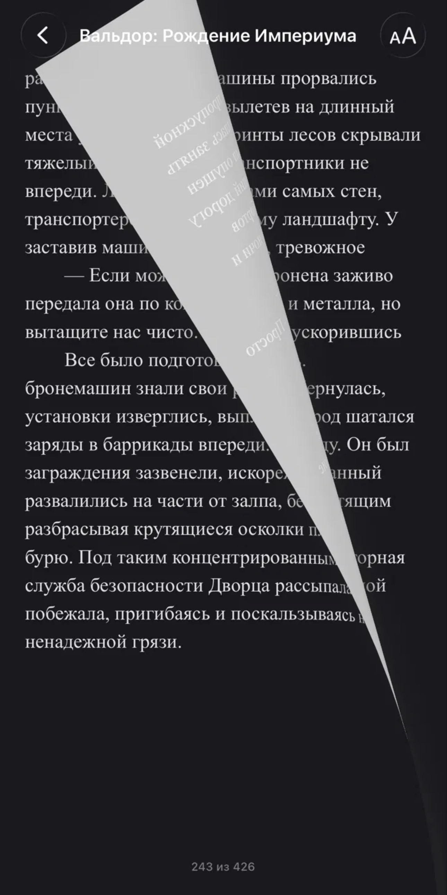

# 📖 Chitalka / Читалка

### Your books. Your pace. / Твои книги. Твой ритм.

A personal e-book reader for iPhone, built with SwiftUI.  
Персональная читалка электронных книг для iPhone на SwiftUI.

**A simple space for reading, without distractions.**  
**Простое пространство для чтения без лишнего.**

---

## ✨ About / О приложении

**EN:** Chitalka is a personal iOS reading app focused on a local book library and comfortable reading. The project is currently in development and testing.

**RU:** «Читалка» — персональное iOS-приложение с собственной библиотекой книг и удобными настройками чтения. Проект находится в разработке и тестировании.

## 📚 Features / Возможности

| English | Русский |
| --- | --- |
| **Book formats:** EPUB, FB2, TXT, FB2.ZIP | **Форматы:** EPUB, FB2, TXT, FB2.ZIP |
| **Personal library:** import books from Files, browse as a list or grid | **Библиотека:** импорт из «Файлов», просмотр списком или сеткой |
| **Reading settings:** font, text size, line spacing, light/sepia/dark themes | **Настройки чтения:** шрифт, размер текста, интервал, светлая/сепия/тёмная темы |
| **Progress and bookmarks:** keep your place and save passages | **Прогресс и закладки:** сохранение места чтения и закладок |
| **Reading statistics:** books finished by year | **Статистика:** прочитанные книги по годам |

> **Development note / Примечание:** These features are present in the current project code, but their stability has not been independently verified. Features may change as development continues.  
> Возможности перечислены по текущему исходному коду; стабильность работы не проверялась независимо. В процессе разработки они могут меняться.

---

## 📸 Screenshots / Скриншоты

### App Icon / Иконка приложения

  

### Actual Reading Screen / Реальный экран чтения

  

**EN:** A real screenshot from the current development build showing the dark reading theme and page-turn animation.  
**RU:** Настоящий скриншот текущей версии приложения: тёмная тема и анимация перелистывания страницы.

### UI Design Reference / Визуальный референс

  

> **EN:** This image is a design reference, **not a screenshot or confirmed feature list of the current app**. Some elements and supported formats in the reference may not exist in the actual application.  
> **RU:** Это визуальный референс, **не скриншот и не подтверждённый список функций текущего приложения**. Часть показанных элементов и форматов может отсутствовать в реальной версии.

---

## 📱 Availability / Доступность

**EN:** The application is in development. **No public installation or download is available yet** through this repository. There is currently no App Store or TestFlight distribution link.

**RU:** Приложение находится в разработке. **Публичного скачивания и установки пока нет**. Ссылки на App Store или TestFlight отсутствуют.

---

## 🔒 Source Code / Исходный код

**EN:** This public repository is a **project showcase only**. The Swift source code and Xcode project are stored separately in a **private repository**. No source files or application builds are published here.

**RU:** Этот публичный репозиторий — **только презентация проекта**. Исходный код Swift и проект Xcode хранятся отдельно, в **приватном репозитории**. Здесь нет исходников и сборок приложения.

---

Developed by **[Nomad](https://github.com/PetrShestakov)**  
Разработчик — **[Nomad](https://github.com/PetrShestakov)**

